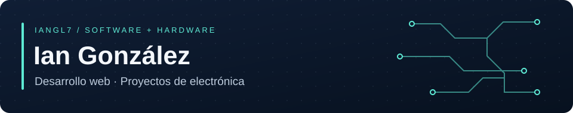

Desarrollo aplicaciones web y exploro proyectos de electrónica que conectan software y hardware.

[**Visita mi portafolio ↗**](https://portafolio-ian-gl.vercel.app) · [Repositorios](https://github.com/IanGL7?tab=repositories)

### Desarrollo web
Trabajo con **TypeScript, JavaScript, Angular y Next.js**, además de **Java** para proyectos de backend. Mis repositorios incluyen aplicaciones de chat, sitios web y comercio electrónico.

### Electrónica
Estoy explorando **ESP32, sistemas embebidos y pantallas**, y aprendiendo sobre **SPI, I²C y UART**. Este espacio también irá reuniendo mis prácticas y proyectos de hardware, con código, conexiones y resultados.

### Proyectos para conocer mi trabajo
- [**Portafolio IanGL**](https://github.com/IanGL7/Portafolio-IanGL) — Presentación de proyectos con Next.js, React y TypeScript.
- [**ChatARmony**](https://github.com/IanGL7/ChatARmony) — Frontend del proyecto ARmony con Angular y TypeScript.
- [**Metztli**](https://github.com/IanGL7/metztli-landing) — Sitio web desarrollado con Astro.
- [**E-Commerce Hoodies**](https://github.com/IanGL7/E-Commerce-Hoodies) — Proyecto de comercio electrónico con Laravel y Blade.
